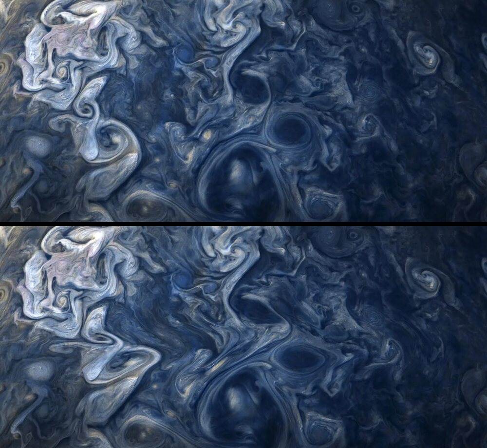

%% Draft written with Claude while building the site. Rewrite in my own words before setting draft: false. %%

The photo at the top of the front page has been my screensaver for years. It shows clouds and storms on Jupiter, taken by NASA's Juno spacecraft. For this site I wanted it to move the way the clouds would: push it and it flows, circle a storm and it spins, leave it alone and it settles back to what Juno saw.

## Moving a photo like a fluid

The obvious approach is to treat the pixels as dye and push them around with a simulated flow. That works for a few seconds. Every step resamples the image with bilinear interpolation, which acts like a small blur, and after a while the clouds turn to mush.

So the photo never moves. What moves is a map that says, for every point on the screen, where in the photo to look.

## The fluid

The flow is a two-dimensional incompressible fluid with damping:

$$
\frac{\partial \mathbf{u}}{\partial t} + (\mathbf{u}\cdot\nabla)\,\mathbf{u} = -\nabla p + \mathbf{f} - \gamma\,\mathbf{u},
\qquad \nabla\cdot\mathbf{u} = 0
$$

It is solved with Jos Stam's stable fluids method on a coarse grid, about $141 \times 64$ cells on a wide screen. Each frame:

1. **Advection.** Trace each cell backwards along the flow and take the velocity found there: $\mathbf{u}^*(\mathbf{x}) = \mathbf{u}\big(\mathbf{x} - \Delta t\,\mathbf{u}(\mathbf{x})\big)$.
2. **Projection.** Remove the divergence. Solve $\nabla^2 p = \nabla\cdot\mathbf{u}^*$ with 22 Jacobi iterations,
   $$
   p_{i,j} \leftarrow \tfrac14\left(p_{i+1,j} + p_{i-1,j} + p_{i,j+1} + p_{i,j-1} - (\nabla\cdot\mathbf{u}^*)_{i,j}\right),
   $$
   then set $\mathbf{u} = \mathbf{u}^* - \nabla p$.
3. **Vorticity confinement.** The coarse grid smears out small eddies, so they are pushed back in. With $\omega = \nabla\times\mathbf{u}$ and $\mathbf{N} = \nabla|\omega| \,/\, \lVert\nabla|\omega|\rVert$, add the force $\varepsilon\,(\mathbf{N}\times\boldsymbol{\omega})$. I keep $\varepsilon$ small: a large value invents eddies at the size of a single grid cell, much smaller than Jupiter's storms.
4. **Viscosity.** Blend each cell towards the average of its four neighbours, $\mathbf{u} \leftarrow (1-\alpha)\,\mathbf{u} + \alpha\,\bar{\mathbf{u}}$. A ripple one cell wide flips sign from cell to cell, so its average is its negative and it is gone within a few frames. A swirl many cells wide is almost equal to its average and survives. Without this step the projection lets a checkerboard pattern through (its central differences cannot see it), and it shows up as a fine wiggle along every cloud edge.

All of it runs in fragment shaders, one texture per field.

## The reference map

Let $\boldsymbol{\phi}(\mathbf{x}, t)$ be the point in the photo whose cloud is currently at $\mathbf{x}$. It is carried along by the flow, $\partial_t \boldsymbol{\phi} + (\mathbf{u}\cdot\nabla)\boldsymbol{\phi} = 0$, and the screen shows $I_\text{photo}(\boldsymbol{\phi}(\mathbf{x}))$.

I store the displacement $\mathbf{d} = \boldsymbol{\phi} - \mathbf{x}$ rather than $\boldsymbol{\phi}$ itself, because it is small and half-float textures are precise near zero. The update becomes

$$
\mathbf{d}^{\,n+1}(\mathbf{x}) = \mathbf{d}^{\,n}\big(\mathbf{x} - \Delta t\,\mathbf{u}\big) - \Delta t\,\mathbf{u},
\qquad \mathbf{d} \leftarrow e^{-k\,\Delta t}\,\mathbf{d}.
$$

The second factor pulls every cloud back home with a time constant of $1/k \approx 6.7\,\text{s}$. Because the photo is sampled exactly once per frame, at full resolution, it stays sharp however long the simulation runs.

## Pointer and storms

Moving the pointer adds a Gaussian impulse along the path. Faster strokes push harder and wider, so slow movements nudge the clouds and a flick drags a jet across the planet.

Thirteen storms in the photo are marked by hand. When the pointer moves near one, the angle it sweeps around the storm's centre,

$$
\Delta\theta = \operatorname{atan2}(\mathbf{a}\times\mathbf{b},\ \mathbf{a}\cdot\mathbf{b}),
$$

is added to the storm's spin $\Omega$, which then decays with $\tau = 1.6\,\text{s}$. Inside the storm the velocity is blended towards solid rotation $\Omega\,\hat{\mathbf{z}}\times\mathbf{r}$. Circle a storm and it winds up; let go and it unwinds. At rest each storm slowly twists back and forth, so the planet never looks frozen.

> [!note] Cost
> About 30 full-screen shader passes per frame on small textures, plus one pass at screen resolution. The simulation pauses when the photo scrolls out of view, and it does not start at all if your system asks for reduced motion.

The code is in `src/scripts/jupiter/` in the site repository (copied here as `reference/`).
